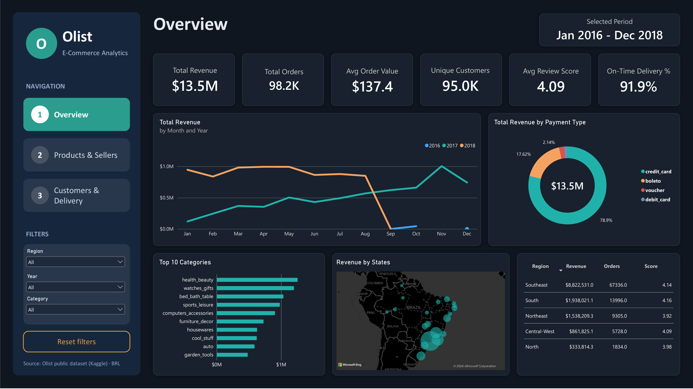
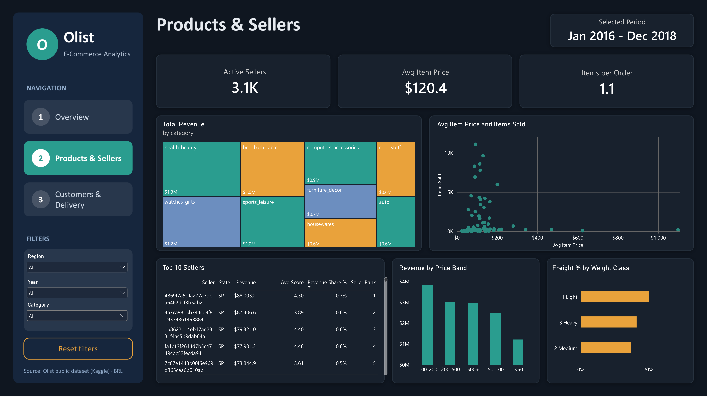
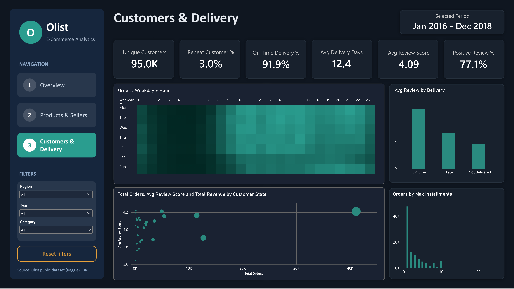
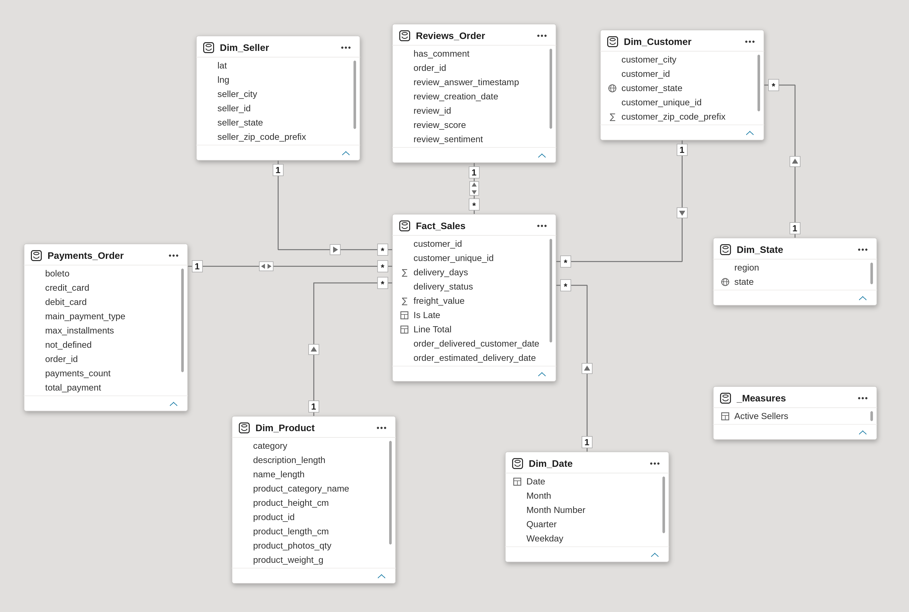

# Olist E-Commerce Analytics | Power BI Dashboard

An interactive, three-page Power BI report analyzing sales, products, sellers, customers and delivery performance of the Brazilian marketplace **Olist** (January 2016 – December 2018). The report is built on a star-schema data model and answers key business questions about revenue, seller concentration, customer behavior and the impact of delivery on customer satisfaction.



---

## Headline Numbers

| Total Revenue | Total Orders | Avg Order Value | Unique Customers | Avg Review Score | On-Time Delivery |
|:---:|:---:|:---:|:---:|:---:|:---:|
| **$13.5M** | **98.2K** | **$137.4** | **95.0K** | **4.09** | **91.9%** |

> Values are in Brazilian reais (BRL) and shown with a `$` symbol in the visuals.

---

## Business Questions

1. How do revenue and order volume evolve over time?
2. Which product categories and price bands drive revenue?
3. Which regions and states generate the most sales, and where is customer satisfaction lowest?
4. How concentrated is revenue among sellers?
5. How does delivery performance affect customer reviews?
6. How do customers pay, and when do they place orders?

---

## Key Insights

- **Revenue is heavily concentrated in the Southeast.** The region generates about **$8.8M (~65%)** of total revenue and ~67K of 98K orders. South ($1.9M) and Northeast ($1.5M) follow; North is the smallest at $0.3M.
- **Customer satisfaction is lowest in the Northeast (3.92)**, compared with 4.14–4.16 in the Southeast and South.
- **Revenue grew strongly through 2017**, rising from roughly $0.1M in January to about $1.0M per month by November, and stayed near $1.0M per month through August 2018. The drop to zero after that point most likely reflects the end of the dataset's coverage rather than a real decline.
- **Credit cards dominate payments (78.9% of revenue)**, followed by boleto (17.6%). Nearly half of all orders use a single installment.
- **Top categories:** health_beauty ($1.3M), watches_gifts ($1.2M), bed_bath_table ($1.0M) and sports_leisure ($1.0M).
- **The 100–200 price band earns the most revenue** (about $3.8M); the cheapest items (under 50) earn the least (about $1.2M).
- **The seller base is fragmented.** The top seller accounts for only 0.7% of revenue and the top five each hold 0.5–0.7%. All top-five sellers are located in the state of SP.
- **Delivery quality strongly drives satisfaction.** Orders delivered on time average roughly 4.3 stars, versus roughly 2.5 for late orders and below 2 for undelivered ones. Overall, 91.9% of orders arrive on time, with an average delivery time of 12.4 days.
- **Repeat purchases are rare:** only 3.0% of customers ordered more than once, and 77.1% of reviews are positive.
- **Order timing:** volume ramps up from 08:00, stays high on weekdays between about 10:00 and 16:00 with a second peak around 20:00–21:00, and is lowest overnight. Weekends are noticeably quieter during the day.

> Figures read from charts (such as price-band revenue and average review by delivery status) are approximate.

---

## Dashboard Pages

### 1. Overview
Revenue, orders, average order value, customers, review score and on-time delivery at a glance, with revenue trend by month and year, revenue by payment type, top 10 categories, a revenue map by state and a regional summary table.


### 2. Products & Sellers
Active sellers, average item price and items per order, plus a category treemap, a price-versus-volume scatter plot, a top-10 sellers table (with revenue share and rank), revenue by price band and freight share by weight class.



### 3. Customers & Delivery
Repeat customer rate, on-time delivery, delivery days and positive review share, with an orders heatmap by weekday and hour, average review by delivery status, orders by maximum installments, and a state-level bubble chart of orders, review score and revenue.



### Interactivity
- Page navigation buttons (Overview, Products & Sellers, Customers & Delivery)
- Slicers for **Region**, **Year** and **Category**
- **Reset filters** button
- Cross-filtering between visuals and a *Selected Period* card

---

## Data Model

The model follows a star schema with `Fact_Sales` at the center, supported by dimension tables and two order-level tables for payments and reviews.



| Table | Type | Description |
|---|---|---|
| `Fact_Sales` | Fact | Order items with price, freight, delivery dates, delivery status and calculated columns (`delivery_days`, `Is Late`, `Line Total`) |
| `Dim_Customer` | Dimension | Customer ID, city, state and ZIP prefix |
| `Dim_Product` | Dimension | Product attributes and category |
| `Dim_Seller` | Dimension | Seller ID, city, state and coordinates |
| `Dim_Date` | Dimension | Calendar table (month, month number, quarter, weekday) |
| `Dim_State` | Dimension | State-to-region mapping |
| `Payments_Order` | Order-level | Payment methods, main payment type, installments and total payment per order |
| `Reviews_Order` | Order-level | Review score, comment flag and sentiment per order |
| `_Measures` | Measures | Dedicated table for DAX measures |

Relationships are one-to-many from each dimension (and order-level table) to `Fact_Sales`; `Dim_State` filters `Dim_Customer`.

---

## KPIs and DAX Measures

The report uses a dedicated `_Measures` table. Main measures include:

| Area | Measures |
|---|---|
| Sales | Total Revenue, Total Orders, Avg Order Value, Avg Item Price, Items per Order |
| Customers | Unique Customers, Repeat Customer %, Positive Review %, Avg Review Score |
| Delivery | On-Time Delivery %, Avg Delivery Days |
| Sellers | Active Sellers, Revenue Share %, Seller Rank |

---

## Tools & Techniques

- **Power BI Desktop**: report design, dark theme, custom navigation and slicer panel
- **Power Query**: data cleaning, type conversion and building dimension and order-level tables
- **DAX**: measures and calculated columns
- **Data modeling**: star schema with a calendar table and a region mapping
- **Visuals**: line and column charts, donut, treemap, scatter and bubble charts, heatmap matrix, map, tables and KPI cards

---

## Repository Structure

```
olist-ecommerce-powerbi-analysis/
├── README.md
├── .gitignore
├── data/
│   └── README.md                 # where to download the raw data
├── powerbi/
│   └── Olist_Dashboard.pbix      # Power BI report
├── docs/
│   ├── data_model.png            # data model diagram
│   └── presentation.pdf          # project presentation
└── images/
    ├── dashboard_overview.png
    ├── dashboard_sales.png
    └── dashboard_customers.png
```

---

## How to Open the Report

1. Install [Power BI Desktop](https://powerbi.microsoft.com/desktop/) (free, Windows).
2. Download `powerbi/Olist_Dashboard.pbix` from this repository.
3. Open the file in Power BI Desktop. The data is embedded in the report, so it opens without extra setup.
4. To refresh the data, download the CSV files from Kaggle (see below), then go to **Transform data → Data source settings** and point the source paths to your local copy.

---

## Data Source

[Brazilian E-Commerce Public Dataset by Olist](https://www.kaggle.com/datasets/olistbr/brazilian-ecommerce) on Kaggle (real, anonymized commercial data, 2016–2018). The dataset is licensed under **CC BY-NC-SA 4.0** and is used here for educational and portfolio purposes only. Raw files are not included in this repository because of their size; see [`data/README.md`](data/README.md).

---

## Notes and Limitations

- The dataset covers 2016–2018; 2016 contains only a few months of data and the last months of 2018 are incomplete, which affects year-over-year comparisons.
- The dataset contains no cost or margin data, so profitability is not analyzed.
- Review scores reflect only customers who left a review.

---

## Author

**Giorgi Lagvilava**
Junior Data Analyst | SQL · Power BI · Excel
[LinkedIn](https://www.linkedin.com/in/YOUR-PROFILE) · [Email](mailto:YOUR-EMAIL@example.com)
